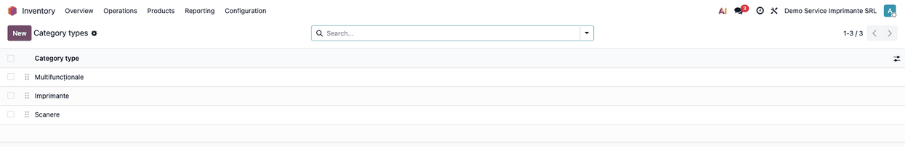
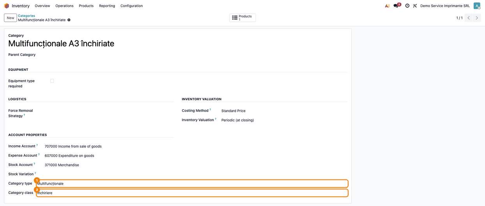
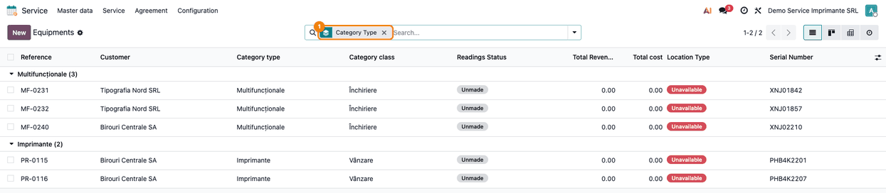

========================
Equipment Category Group
========================

..
   !!!!!!!!!!!!!!!!!!!!!!!!!!!!!!!!!!!!!!!!!!!!!!!!!!!!
   !! This file is generated by oca-gen-addon-readme !!
   !! changes will be overwritten.                   !!
   !!!!!!!!!!!!!!!!!!!!!!!!!!!!!!!!!!!!!!!!!!!!!!!!!!!!
   !! source digest: sha256:7f3152726cf0a3ecf09d35ef84472c25c91eff3decd49ed65ad1f7b0307d1c08
   !!!!!!!!!!!!!!!!!!!!!!!!!!!!!!!!!!!!!!!!!!!!!!!!!!!!

.. |badge1| image:: https://img.shields.io/badge/maturity-Beta-yellow.png
    :target: https://odoo-community.org/page/development-status
    :alt: Beta
.. |badge2| image:: https://img.shields.io/badge/github-dhongu%2Fdeltatech_service-lightgray.png?logo=github
    :target: https://github.com/dhongu/deltatech_service/tree/19.0/deltatech_category_group_equipment
    :alt: dhongu/deltatech_service
.. |badge_fisa| image:: https://img.shields.io/badge/-Fi%C8%99%C4%83%20consultant-2ea44f.png
    :target: https://github.com/dhongu/deltatech_service/blob/19.0/deltatech_category_group_equipment/readme/FISA_CONSULTANT.md
    :alt: Fișă consultant
.. |badge_tests| image:: https://img.shields.io/badge/-3%20automated%20tests%20%C2%B7%20100%25%20code%20coverage-2ea44f.png
    :target: https://app.codecov.io/gh/dhongu/deltatech_service/tree/19.0/deltatech_category_group_equipment
    :alt: 3 automated tests · 100% code coverage

|badge1| |badge2| |badge_fisa| |badge_tests|

Internal Category Groups tags product categories with a type and a
class. This module carries the same two groupings over to service
equipment, so equipment can be grouped the way its product is.

- **Type and class**: Each equipment gets a read-only *Category type*
  and *Category class*, taken from the category of its *Product*.
- **List columns**: The equipment list offers both fields as optional
  columns, hidden by default.
- **Search and grouping**: The equipment search accepts both fields and
  adds the group-by filters *Category Type* and *Category Class*.

The module depends on *Services Equipment*
(``deltatech_service_equipment``) and *Internal Category Groups*
(``deltatech_category_group``), which defines the types and classes. It
changes only the list and search views of equipment, adds no menus or
security rules.

**Table of contents**

.. contents::
   :local:

Usage
=====

Configuration
-------------

The types and classes come from *Internal Category Groups*
(``deltatech_category_group``):

1. Define the types in **Inventory → Configuration → Products → Category
   options → Category types** and the classes in **Category classes**.

   |Category types list with three rows: Multifuncționale, Imprimante
   and Scanere|

2. Open a product category (**Inventory → Configuration → Products →
   Categories**) and set its **Category type** and **Category class**.

   |Product category form; the Category type and Category class fields
   are highlighted at the bottom|

Equipment whose product is in the category gets its type and class right
away.

Usage
-----

1. Show the columns
~~~~~~~~~~~~~~~~~~~

Open **Service → Master data → Equipment**. **Category type** and
**Category class** are optional columns, hidden by default: tick them in
the optional columns menu at the right of the list header. They are
read-only and follow the category of the equipment's **Product**.

|Equipment list with the Category type and Category class columns shown
and highlighted; three multifunction printers and two laser printers|

2. Group the equipment
~~~~~~~~~~~~~~~~~~~~~~

In the search panel, under **Group By**, pick **Category Type** or
**Category Class**. You can also search equipment by type or class.

|Equipment list grouped by Category Type: one group with 3 equipment and
one with 2|

.. |Equipment list with the Category type and Category class columns shown and highlighted; three multifunction printers and two laser printers| image:: https://raw.githubusercontent.com/dhongu/deltatech_service/19.0/deltatech_category_group_equipment/static/description/en/03_echipamente_tip_clasa.png

Changelog
=========

19.0.0.0.5 (2026-11-11)
-----------------------

- Apps Store page: a fuller description (what the module does, the
  problem it solves, its main functions, dependencies and limits). No
  change in behavior.

19.0.0.0.4 (2026-10-09)
-----------------------

- Apps Store banner (banner.json).

19.0.0.0.3 (2026-09-30)
-----------------------

- Own module icon in the flat style of the other modules.

Bug Tracker
===========

Bugs are tracked on `Terrabit Issues <https://www.terrabit.ro/helpdesk>`_.
In case of trouble, please check there if your issue has already been reported.

Do not contact contributors directly about support or help with technical issues.

Credits
=======

Authors
-------

* Terrabit
* Dan Stoica

Maintainers
-----------

.. |maintainer-dhongu| image:: https://github.com/dhongu.png?size=40px
    :target: https://github.com/dhongu
    :alt: dhongu
.. |maintainer-danila12| image:: https://github.com/danila12.png?size=40px
    :target: https://github.com/danila12
    :alt: danila12

Current maintainers:

|maintainer-dhongu| |maintainer-danila12| 

This module is part of the `dhongu/deltatech_service <https://github.com/dhongu/deltatech_service/tree/19.0/deltatech_category_group_equipment>`_ project on GitHub.

You are welcome to contribute.