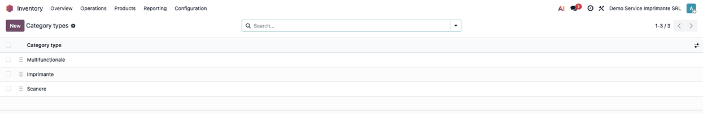
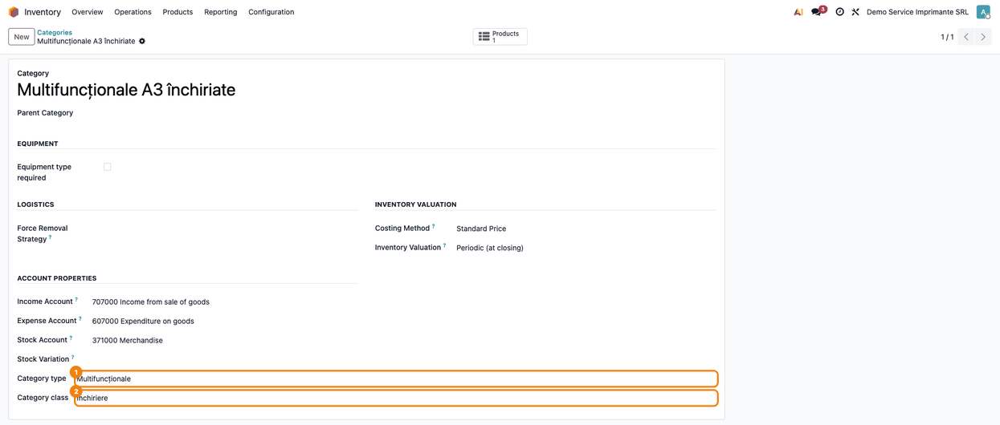
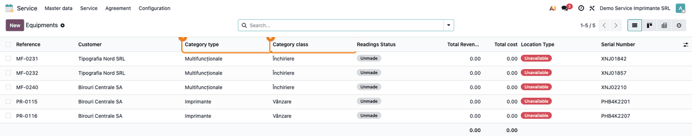
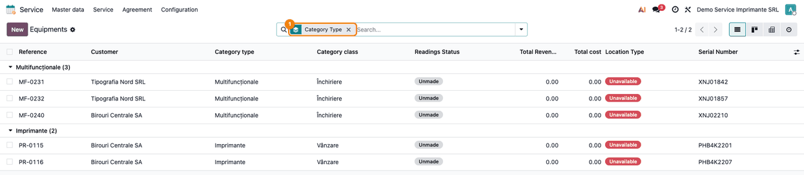

## Configuration

The types and classes come from *Internal Category Groups* (`deltatech_category_group`):

1. Define the types in **Inventory → Configuration → Products → Category options → Category types** and the classes in
   **Category classes**.

   

2. Open a product category (**Inventory → Configuration → Products → Categories**) and set its **Category
   type** and **Category class**.

   

Equipment whose product is in the category gets its type and class right away.

## Usage

### 1. Show the columns

Open **Service → Master data → Equipment**. **Category type** and **Category class** are optional columns,
hidden by default: tick them in the optional columns menu at the right of the list header. They are
read-only and follow the category of the equipment's **Product**.

### 2. Group the equipment

In the search panel, under **Group By**, pick **Category Type** or **Category Class**. You can also search
equipment by type or class.

