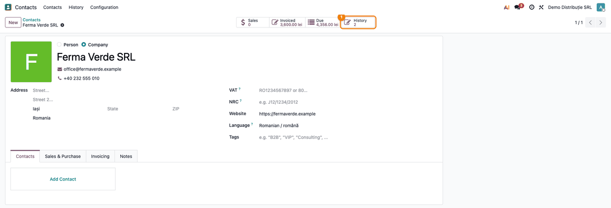
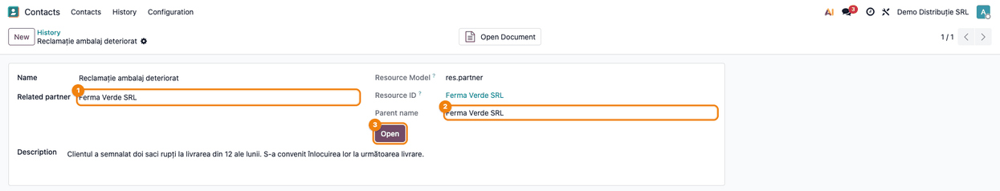
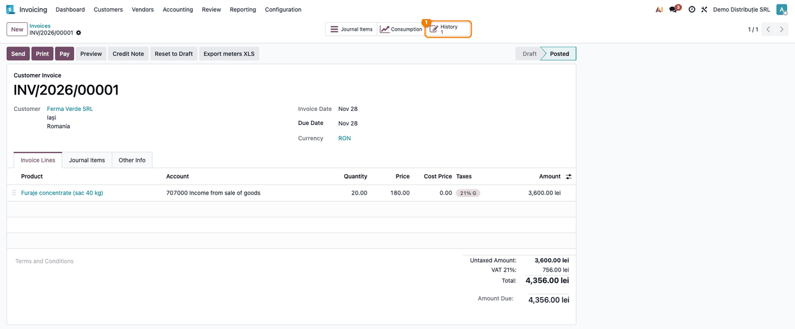
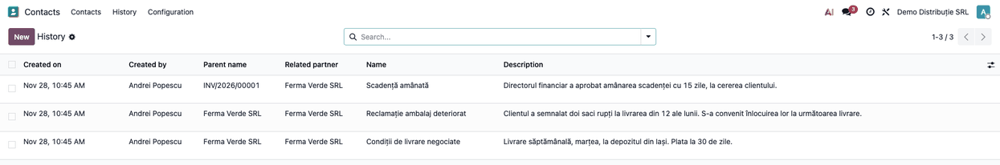

==============
Object History
==============

..
   !!!!!!!!!!!!!!!!!!!!!!!!!!!!!!!!!!!!!!!!!!!!!!!!!!!!
   !! This file is generated by oca-gen-addon-readme !!
   !! changes will be overwritten.                   !!
   !!!!!!!!!!!!!!!!!!!!!!!!!!!!!!!!!!!!!!!!!!!!!!!!!!!!
   !! source digest: sha256:f374096fae25dd9b848fd350a3039cb12804952aefda722ec171212880d44337
   !!!!!!!!!!!!!!!!!!!!!!!!!!!!!!!!!!!!!!!!!!!!!!!!!!!!

.. |badge1| image:: https://img.shields.io/badge/maturity-Beta-yellow.png
    :target: https://odoo-community.org/page/development-status
    :alt: Beta
.. |badge2| image:: https://img.shields.io/badge/github-dhongu%2Fdeltatech_service-lightgray.png?logo=github
    :target: https://github.com/dhongu/deltatech_service/tree/19.0/deltatech_object_history
    :alt: dhongu/deltatech_service
.. |badge_fisa| image:: https://img.shields.io/badge/-Fi%C8%99%C4%83%20consultant-2ea44f.png
    :target: https://github.com/dhongu/deltatech_service/blob/19.0/deltatech_object_history/readme/FISA_CONSULTANT.md
    :alt: Fișă consultant
.. |badge_tests| image:: https://img.shields.io/badge/-10%20automated%20tests%20%C2%B7%2074%25%20code%20coverage-2ea44f.png
    :target: https://app.codecov.io/gh/dhongu/deltatech_service/tree/19.0/deltatech_object_history
    :alt: 10 automated tests · 74% code coverage

|badge1| |badge2| |badge_fisa| |badge_tests|

Chatter messages mix with automatic notifications and are sometimes
cleaned up. This module keeps a separate history of internal notes
(``object.history``) attached to Odoo documents.

- **History button**: Partners, invoices / journal entries and stock
  transfers get a *History* button with the number of rows, for users of
  the *Object history admin* group. It opens the rows of that document.
- **History rows**: Each row has a title, a formatted description, a
  *Related partner*, the linked document and its name, the author and
  the date, plus its own chatter. *Open Document* goes back to the
  original record.
- **Add from Action**: On a partner form, *Actions → Add history* adds a
  row for that partner.
- **History list**: *Contacts → History → History lines* lists all rows,
  with the filters *Partners*, *Moves* and *Transfers* and grouping by
  partner or by document type.
- **Kept rows**: No user can delete history rows; *Object history admin*
  can only archive them.

Rows are visible only to users who can read their document; rows of
deleted documents stay visible to *Object history admin*. A row takes
the company of its document; for a document shared between companies
(e.g. a partner without a company) it takes the user's current company.
Rows added with *Add history* do not fill *Related partner* and *Parent
name*. *Deltatech Object History for Service*
(``deltatech_object_history_service``) adds the same history to service
agreements and equipment.

**Table of contents**

.. contents::
   :local:

Usage
=====

Configuration
-------------

Give the **Object history admin** group to the users who keep the
history (Settings → Users & Companies → Users). The administrator gets
it on install. Only this group sees the **History** button and the
**Contacts → History** menu.

Usage
-----

1. Open the history of a partner
~~~~~~~~~~~~~~~~~~~~~~~~~~~~~~~~

Open a partner in **Contacts**. The **History** button shows how many
history rows the partner has.

|Partner form of Ferma Verde SRL; the History button with the count 2 is
highlighted next to Sales, Invoiced and Due|

Click **History** to list the rows of the partner, newest first. **New**
in this list creates a row already linked to the partner, with **Related
partner** and **Parent name** filled in.

|History list opened from the partner: two rows by Andrei Popescu with
the columns Created on, Created by, Parent name, Related partner, Name
and Description|

2. Add a row from the Action menu
~~~~~~~~~~~~~~~~~~~~~~~~~~~~~~~~~

On the partner form, click **⚙ Actions → Add history**, fill in **Name**
(required) and **Description**, then click **Add**. A row added this way
has no **Related partner** and no **Parent name**; to get them, use
**New** from the **History** button instead. This action exists only on
partners.

|Add history dialog over the partner form: the Name and Description
fields and the Add button are highlighted; Resource Model res.partner
and Resource ID Ferma Verde SRL on the right|

3. Read a history row
~~~~~~~~~~~~~~~~~~~~~

A row shows its **Name**, **Related partner** (required when saving),
the linked document (**Resource Model**, **Resource ID**, **Parent
name**) and the **Description**. **Open Document** and **Open** go back
to the original record. Each row has its own chatter.

|History row form: Related partner and Parent name Ferma Verde SRL and
the Open button are highlighted; the description is below|

4. History on invoices and transfers
~~~~~~~~~~~~~~~~~~~~~~~~~~~~~~~~~~~~

The same **History** button appears on invoices / journal entries and on
stock transfers. **New** from its list fills in **Parent name** with the
document number; choose the **Related partner** before saving.

|Posted customer invoice INV/2026/00001 for Ferma Verde SRL; the History
button with the count 1 is highlighted|

5. Search all rows
~~~~~~~~~~~~~~~~~~

**Contacts → History → History lines** lists every row you can access.
Use the filters **Partners**, **Moves** and **Transfers**, or group by
**Partner** or by **Parent** (the document type).

|History lines list with three rows by Andrei Popescu: one on the
invoice INV/2026/00001 and two on the partner Ferma Verde SRL|

Rows are visible only to users who can read their document. No user can
delete a row; **Object history admin** can archive rows from the list
(**Actions → Archive**).

.. |History list opened from the partner: two rows by Andrei Popescu with the columns Created on, Created by, Parent name, Related partner, Name and Description| image:: https://raw.githubusercontent.com/dhongu/deltatech_service/19.0/deltatech_object_history/static/description/en/03_istoric_partener.png
.. |Add history dialog over the partner form: the Name and Description fields and the Add button are highlighted; Resource Model res.partner and Resource ID Ferma Verde SRL on the right| image:: https://raw.githubusercontent.com/dhongu/deltatech_service/19.0/deltatech_object_history/static/description/en/02_adaugare_istoric.png

Changelog
=========

19.0.0.0.4 (2026-10-03)
-----------------------

- Every internal user could search and read all history rows, including
  those of other companies and of documents they are not allowed to see.
  History rows now follow a multi-company record rule, and a row
  attached to a document is visible only to users who can read that
  document (search, count and direct reads alike). History of a deleted
  document, or of a model that is no longer installed, is visible only
  to *Object history admin* users.
- A new history row takes the company of its document when the document
  has one, instead of the active company.

19.0.0.0.3 (2026-09-30)
-----------------------

- Own module icon in the flat style of the other modules.

19.0.0.0.2 (2026-09-23)
-----------------------

- Translatable strings in code use ``self.env._()`` instead of ``_()``,
  the Odoo 19 convention (pylint-odoo ``prefer-env-translation``). The
  translated messages are unchanged.

Bug Tracker
===========

Bugs are tracked on `Terrabit Issues <https://www.terrabit.ro/helpdesk>`_.
In case of trouble, please check there if your issue has already been reported.

Do not contact contributors directly about support or help with technical issues.

Credits
=======

Authors
-------

* Terrabit
* Dan Stoica

Maintainers
-----------

.. |maintainer-dhongu| image:: https://github.com/dhongu.png?size=40px
    :target: https://github.com/dhongu
    :alt: dhongu
.. |maintainer-danila12| image:: https://github.com/danila12.png?size=40px
    :target: https://github.com/danila12
    :alt: danila12

Current maintainers:

|maintainer-dhongu| |maintainer-danila12| 

This module is part of the `dhongu/deltatech_service <https://github.com/dhongu/deltatech_service/tree/19.0/deltatech_object_history>`_ project on GitHub.

You are welcome to contribute.