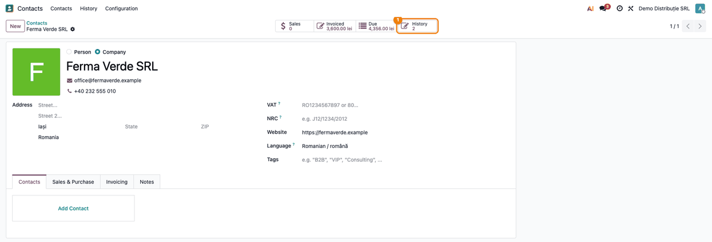
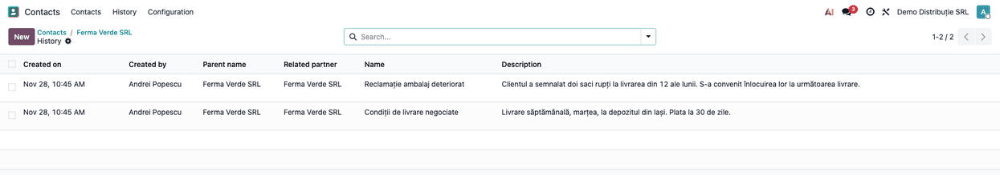
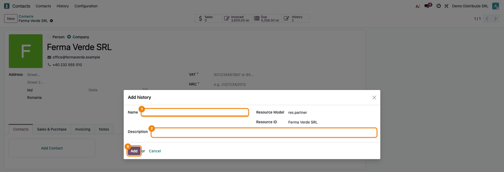
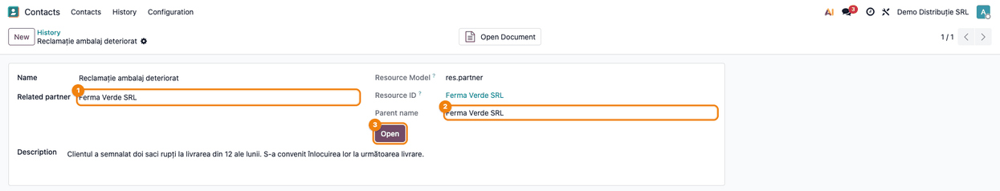
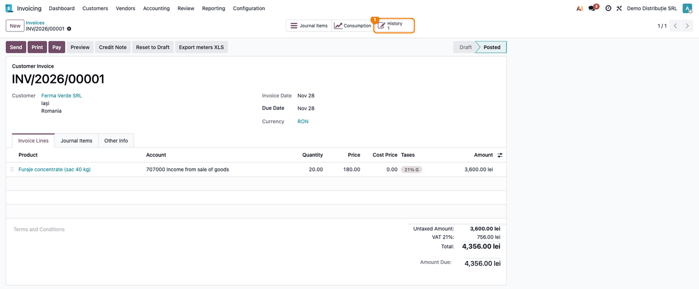
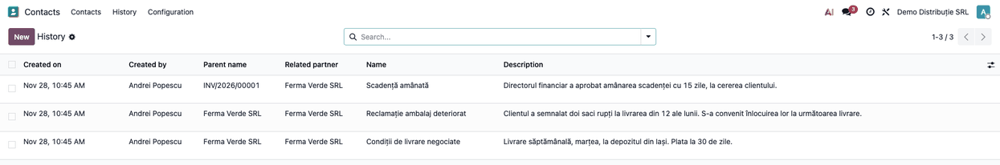

## Configuration

Give the **Object history admin** group to the users who keep the history (Settings → Users & Companies →
Users). The administrator gets it on install. Only this group sees the **History** button and the
**Contacts → History** menu.

## Usage

### 1. Open the history of a partner

Open a partner in **Contacts**. The **History** button shows how many history rows the partner has.

Click **History** to list the rows of the partner, newest first. **New** in this list creates a row already
linked to the partner, with **Related partner** and **Parent name** filled in.

### 2. Add a row from the Action menu

On the partner form, click **⚙ Actions → Add history**, fill in **Name** (required) and **Description**, then
click **Add**. A row added this way has no **Related partner** and no **Parent name**; to get them, use
**New** from the **History** button instead. This action exists only on partners.

### 3. Read a history row

A row shows its **Name**, **Related partner** (required when saving), the linked document (**Resource
Model**, **Resource ID**, **Parent name**) and the **Description**. **Open Document** and **Open** go back
to the original record. Each row has its own chatter.

### 4. History on invoices and transfers

The same **History** button appears on invoices / journal entries and on stock transfers. **New** from its
list fills in **Parent name** with the document number; choose the **Related partner** before saving.

### 5. Search all rows

**Contacts → History → History lines** lists every row you can access. Use the filters **Partners**,
**Moves** and **Transfers**, or group by **Partner** or by **Parent** (the document type).

Rows are visible only to users who can read their document. No user can delete a row; **Object history admin** can archive rows from the list (**Actions → Archive**).
