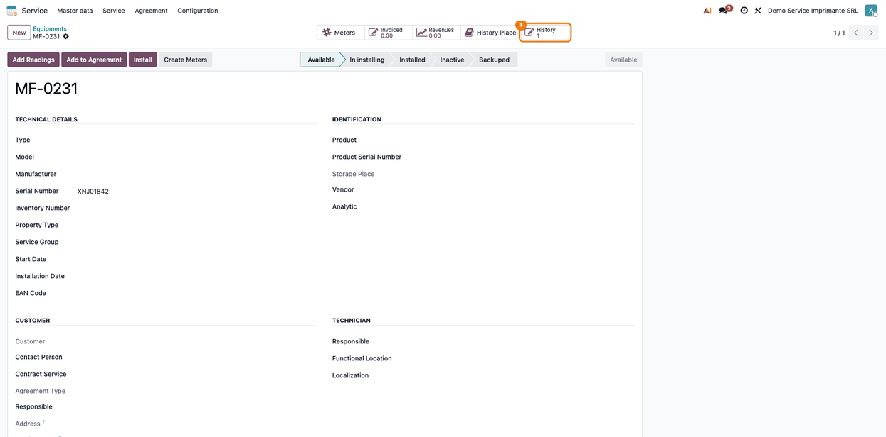
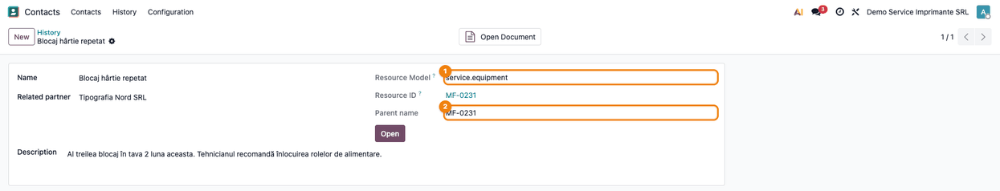

==========================
Object History for Service
==========================

..
   !!!!!!!!!!!!!!!!!!!!!!!!!!!!!!!!!!!!!!!!!!!!!!!!!!!!
   !! This file is generated by oca-gen-addon-readme !!
   !! changes will be overwritten.                   !!
   !!!!!!!!!!!!!!!!!!!!!!!!!!!!!!!!!!!!!!!!!!!!!!!!!!!!
   !! source digest: sha256:a213ec3405f41feea0c9c2f064c46a58a32e28ce1cf6700518f2a9fc9da9c2c2
   !!!!!!!!!!!!!!!!!!!!!!!!!!!!!!!!!!!!!!!!!!!!!!!!!!!!

.. |badge1| image:: https://img.shields.io/badge/maturity-Beta-yellow.png
    :target: https://odoo-community.org/page/development-status
    :alt: Beta
.. |badge2| image:: https://img.shields.io/badge/github-dhongu%2Fdeltatech_service-lightgray.png?logo=github
    :target: https://github.com/dhongu/deltatech_service/tree/19.0/deltatech_object_history_service
    :alt: dhongu/deltatech_service
.. |badge_fisa| image:: https://img.shields.io/badge/-Fi%C8%99%C4%83%20consultant-2ea44f.png
    :target: https://github.com/dhongu/deltatech_service/blob/19.0/deltatech_object_history_service/readme/FISA_CONSULTANT.md
    :alt: Fișă consultant
.. |badge_tests| image:: https://img.shields.io/badge/-3%20automated%20tests-2ea44f.png
    :target: https://github.com/dhongu/deltatech_service/tree/19.0/deltatech_object_history_service/tests
    :alt: 3 automated tests

|badge1| |badge2| |badge_fisa| |badge_tests|

Notes on service agreements and equipment often need to stay apart from
the chatter. This bridge module lets *Object History* notes be kept on
both.

- **History button**: A *History* button with a count appears on the
  agreement and equipment forms, for users of the *Object history admin*
  group. It opens the history rows of that record.
- **Prefilled rows**: A new row opened from the button is attached to
  the record, and its *Parent name* takes the record's name.
- **New filters**: The history search gets *Agreements* and *Equipments*
  filters.

In the Romanian translation the button and the list title are named
*Notite RG*.

The module depends on *Object History* (``deltatech_object_history``),
*Services Agreement* (``deltatech_service_agreement``) and *Services
Equipment* (``deltatech_service_equipment``). Rows are visible only to
users who can read their agreement or equipment. The form requires a
*Related partner*, which is not prefilled.

**Table of contents**

.. contents::
   :local:

Usage
=====

Configuration
-------------

Give the **Object history admin** group (from *Object History*) to the
users who keep the history (Settings → Users & Companies → Users). Only
this group sees the **History** button on agreements and equipment.

Usage
-----

1. History of a service agreement
~~~~~~~~~~~~~~~~~~~~~~~~~~~~~~~~~

Open an agreement in **Service → Agreement → Services Agreements**. The
**History** button shows how many history rows the agreement has.

|Service agreement AG/00007 In Progress for Tipografia Nord SRL; the
History button with the count 2 is highlighted in the button bar|

Click **History** to list the rows of the agreement. **New** in this
list creates a row linked to the agreement, with **Parent name** set to
the agreement number; choose the **Related partner** before saving.

|History list opened from the agreement: two rows by Andrei Popescu with
Parent name AG/00007 and Related partner Tipografia Nord SRL|

2. History of an equipment
~~~~~~~~~~~~~~~~~~~~~~~~~~

The same **History** button is on the equipment form (**Service → Master
data → Equipment**).

|Equipment MF-0231 with serial number XNJ01842; the History button with
the count 1 is highlighted|

A row of an equipment shows **Resource Model** ``service.equipment`` and
the equipment name in **Parent name**. **Open Document** goes back to
the equipment.

|History row form: Resource Model service.equipment and Parent name
MF-0231 are highlighted|

3. Filter agreements and equipment
~~~~~~~~~~~~~~~~~~~~~~~~~~~~~~~~~~

In **Contacts → History → History lines**, open the search panel: the
**Agreements** and **Equipments** filters keep only the rows of
agreements or of equipment.

|History lines with the filter panel open: the Agreements and Equipments
filters are highlighted below Partners, Moves and Transfers|

.. |Service agreement AG/00007 In Progress for Tipografia Nord SRL; the History button with the count 2 is highlighted in the button bar| image:: https://raw.githubusercontent.com/dhongu/deltatech_service/19.0/deltatech_object_history_service/static/description/en/01_contract_buton_istoric.png
.. |History list opened from the agreement: two rows by Andrei Popescu with Parent name AG/00007 and Related partner Tipografia Nord SRL| image:: https://raw.githubusercontent.com/dhongu/deltatech_service/19.0/deltatech_object_history_service/static/description/en/02_istoric_contract.png

.. |History lines with the filter panel open: the Agreements and Equipments filters are highlighted below Partners, Moves and Transfers| image:: https://raw.githubusercontent.com/dhongu/deltatech_service/19.0/deltatech_object_history_service/static/description/en/05_filtre_contracte_echipamente.png

Changelog
=========

19.0.0.0.4 (2026-11-11)
-----------------------

- Apps Store page: a fuller description (what the module does, the
  problem it solves, its main functions, dependencies and limits). No
  change in behavior.

19.0.0.0.3 (2026-10-09)
-----------------------

- Apps Store banner (banner.json).

19.0.0.0.2 (2026-09-30)
-----------------------

- Own module icon in the flat style of the other modules.

Bug Tracker
===========

Bugs are tracked on `Terrabit Issues <https://www.terrabit.ro/helpdesk>`_.
In case of trouble, please check there if your issue has already been reported.

Do not contact contributors directly about support or help with technical issues.

Credits
=======

Authors
-------

* Terrabit
* Dan Stoica

Maintainers
-----------

.. |maintainer-dhongu| image:: https://github.com/dhongu.png?size=40px
    :target: https://github.com/dhongu
    :alt: dhongu
.. |maintainer-danila12| image:: https://github.com/danila12.png?size=40px
    :target: https://github.com/danila12
    :alt: danila12

Current maintainers:

|maintainer-dhongu| |maintainer-danila12| 

This module is part of the `dhongu/deltatech_service <https://github.com/dhongu/deltatech_service/tree/19.0/deltatech_object_history_service>`_ project on GitHub.

You are welcome to contribute.