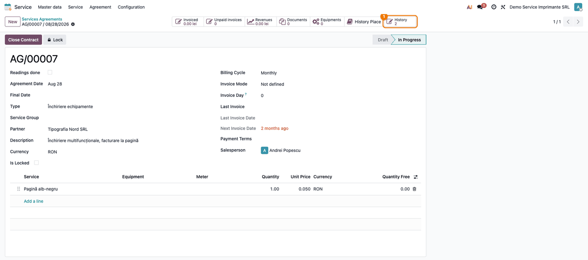
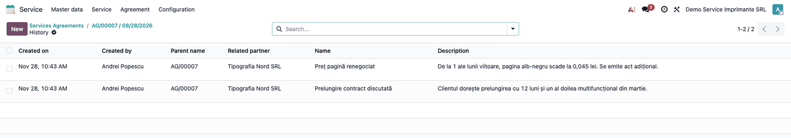
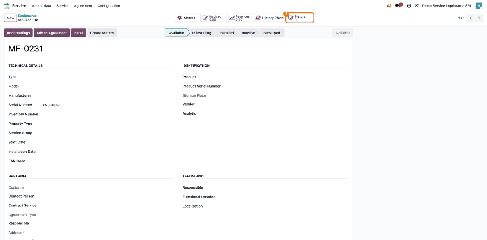
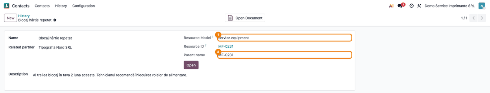
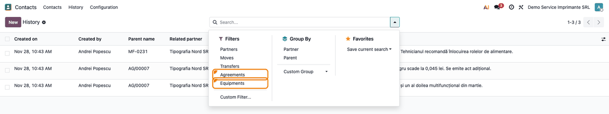

## Configuration

Give the **Object history admin** group (from *Object History*) to the users who keep the history
(Settings → Users & Companies → Users). Only this group sees the **History** button on agreements and
equipment.

## Usage

### 1. History of a service agreement

Open an agreement in **Service → Agreement → Services Agreements**. The **History** button shows how many
history rows the agreement has.

Click **History** to list the rows of the agreement. **New** in this list creates a row linked to the
agreement, with **Parent name** set to the agreement number; choose the **Related partner** before saving.

### 2. History of an equipment

The same **History** button is on the equipment form (**Service → Master data → Equipment**).

A row of an equipment shows **Resource Model** `service.equipment` and the equipment name in **Parent
name**. **Open Document** goes back to the equipment.

### 3. Filter agreements and equipment

In **Contacts → History → History lines**, open the search panel: the **Agreements** and **Equipments**
filters keep only the rows of agreements or of equipment.

