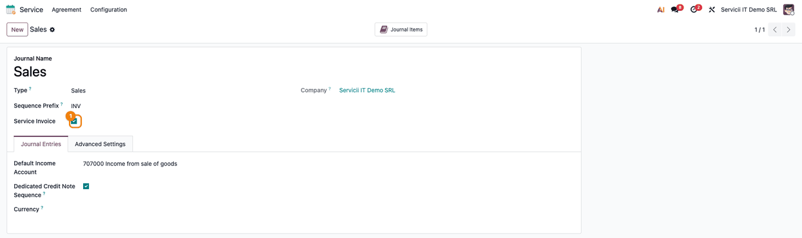
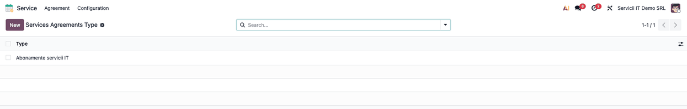
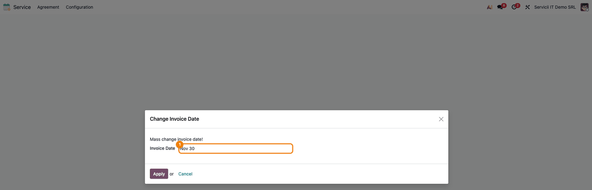
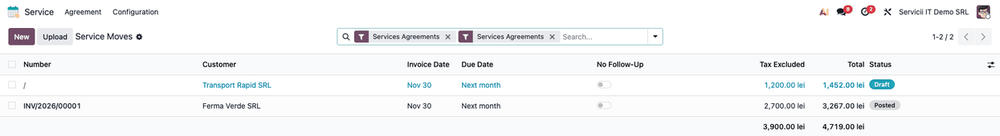

==================
Services Agreement
==================

..
   !!!!!!!!!!!!!!!!!!!!!!!!!!!!!!!!!!!!!!!!!!!!!!!!!!!!
   !! This file is generated by oca-gen-addon-readme !!
   !! changes will be overwritten.                   !!
   !!!!!!!!!!!!!!!!!!!!!!!!!!!!!!!!!!!!!!!!!!!!!!!!!!!!
   !! source digest: sha256:13f7eaa2227d2c325cfe9981b085558c8d7ea67b5b3c8514b1bef977c02ddf54
   !!!!!!!!!!!!!!!!!!!!!!!!!!!!!!!!!!!!!!!!!!!!!!!!!!!!

.. |badge1| image:: https://img.shields.io/badge/maturity-Production%2FStable-green.png
    :target: https://odoo-community.org/page/development-status
    :alt: Production/Stable
.. |badge2| image:: https://img.shields.io/badge/github-dhongu%2Fdeltatech_service-lightgray.png?logo=github
    :target: https://github.com/dhongu/deltatech_service/tree/19.0/deltatech_service_agreement
    :alt: dhongu/deltatech_service
.. |badge_fisa| image:: https://img.shields.io/badge/-Fi%C8%99%C4%83%20consultant-2ea44f.png
    :target: https://github.com/dhongu/deltatech_service/blob/19.0/deltatech_service_agreement/readme/FISA_CONSULTANT.md
    :alt: Fișă consultant
.. |badge_tests| image:: https://img.shields.io/badge/-34%20automated%20tests%20%C2%B7%2083%25%20code%20coverage-2ea44f.png
    :target: https://app.codecov.io/gh/dhongu/deltatech_service/tree/19.0/deltatech_service_agreement
    :alt: 34 automated tests · 83% code coverage

|badge1| |badge2| |badge_fisa| |badge_tests|

Features:

- Define service contracts for each partner and company, with currency,
  billing cycle (monthly, quarterly, yearly or a custom cycle), invoice
  day, payment terms and service lines

  - lines hold quantity, unit price, free quantity and free cycles

- Each period, prepare the planned consumptions of the agreements in
  progress, then correct their quantity, price or invoice date before
  billing

  - bulk price change, distribution of a quantity or amount, and change
    of the invoice date

- Generate the customer invoices from the consumptions, grouped by
  partner, agreement or agreement line

  - a negative consumption becomes a correction that refers to the
    original invoice (credit note if the net amount is negative)

- A daily scheduled action can prepare and invoice the agreements set to
  automatic billing (technical setting, not shown on the form)

**Table of contents**

.. contents::
   :local:

Usage
=====

Configuration
-------------

1. Tick **Service Invoice** on the sales journal used for services
   (Invoicing → Configuration → Journals). The **Service → Agreement →
   Service Invoice** menu only lists invoices of journals with this box
   ticked.

   |Sales journal form with the Service Invoice box ticked under
   Sequence Prefix; the box is highlighted|

2. Create an agreement type in **Service → Configuration → Services
   Agreement Type** and pick the sales journal (required). Optionally
   create **Service Group** records to group agreements in reports.

   |List of service agreement types with a single row, Abonamente
   servicii IT|

3. Check the billing cycles and the service periods (**Service →
   Configuration → Cycle** and **Date Ranges**): preparing the billing
   needs a period for the month you invoice.

Usage
-----

1. Create an agreement
~~~~~~~~~~~~~~~~~~~~~~

Open **Service → Agreement → Services Agreements** and click **New**.

|Agreements list with the columns Reference, Agreement Date, Partner,
Description, Status, Type, Salesperson, Total consumption, Total
invoiced and Company; two agreements are In Progress and one is Draft|

Fill in the **Partner**, the **Billing Cycle** and the **Invoice Day**
(the day of the month; **-1** means the last day of the month, **0**
means no fixed day), the **Payment Terms**, and add the service lines
with quantity, unit price, **Quantity Free** (not invoiced) and,
optionally, **Has free cycles** / **Free cycles**. Click **Set In
Progress** to activate the agreement.

|New agreement in Draft: partner Atelier Mecanic SRL, monthly billing
cycle, invoice day -1, payment terms 30 days and one service line; the
partner, billing cycle, invoice day and the Set In Progress button are
highlighted|

Only agreements **In Progress** are billed. The **Next Invoice Date** is
computed from the last posted invoice (or the agreement date), the cycle
and the invoice day.

|Agreement AG/00001 In Progress with two service lines and the Next
Invoice Date; the Close Contract button and the Next Invoice Date field
are highlighted|

2. Prepare the billing
~~~~~~~~~~~~~~~~~~~~~~

In the agreements list, select the agreements and click **Billing
Preparation** (managers only). Pick the **Period** (required) and click
**Apply**: one consumption in the state *Without invoice* is created for
each agreement line.

|Billing Preparation window with the Period field open and the period
2026/11 listed, above the list of agreements in progress; the Period
field and the Apply button are highlighted|

3. Check and correct the consumptions
~~~~~~~~~~~~~~~~~~~~~~~~~~~~~~~~~~~~~

Open **Service → Agreement → Services Consumption**. While a consumption
is *Without invoice* you can correct its quantity, price or partner on
its form.

|Services Consumption list with three consumptions for period 2026/11,
quantities 10, 1 and 1 and prices 150 and 1,200; the quantity and price
of the first row are highlighted|

Select consumptions and use the **Action** menu for bulk changes:

- **Price Change**: sets a new unit price, currency and reference on the
  selected unbilled consumptions of a product. It also updates the list
  price of the product.

  |Price Change window with product Suport tehnic (ore), unit price 150,
  currency RON and an empty Reference field; the unit price and the
  reference are highlighted|

- **Distribution**: spreads a quantity or an amount over the selected
  consumptions (**Fix** gives each one the entered value, **Divide**
  splits it equally).

  |Distribution window with distribution type Quantity, mode Fix,
  product Suport tehnic (ore) and quantity 10; the type, mode and
  quantity are highlighted|

- **Change Invoice Date**: sets the invoice date of the selected
  unbilled consumptions.

  |Change Invoice Date window with the date Nov 30 filled in; the
  Invoice Date field is highlighted|

4. Invoice
~~~~~~~~~~

Open **Service → Agreement → Billing** (or select consumptions and use
**Action → Billing**). Choose the **Journal**, how invoices are grouped
(**Group by agreement**, **Group by partner** or **Split by agreement
line**) and optionally **Group by service**, then click **Apply**. Draft
customer invoices are created and the consumptions become *With
invoice*. Consumptions that do not exceed the free quantity become *Not
Applicable*. A consumption with a negative quantity is invoiced as a
correction that refers to the original invoice; if the net amount of the
document is negative, a credit note is created.

|Billing window with journal Sales, group by agreement, Group by service
unticked and the list of the three consumptions; the journal and
grouping fields are highlighted|

5. Check and post the invoices
~~~~~~~~~~~~~~~~~~~~~~~~~~~~~~

The generated invoices open automatically; later use **Service →
Agreement → Service Invoice**.

|List of service invoices: one posted invoice for Ferma Verde SRL and
one draft for Transport Rapid SRL, both dated Nov 30|

Open an invoice, check its lines and the note referring to the
agreement, then confirm it. The **Consumption** smart button opens its
consumptions.

|Posted customer invoice INV/2026/00001 for Ferma Verde SRL with two
service lines at 21% VAT and the Consumption button highlighted|

|Journal Items tab of the posted invoice: 411100 Customers debit 3,267
lei, 704000 credit 1,500 and 1,200 lei and 442700 VAT collected credit
567 lei|

On posting, the agreement stores the **Last Invoice** and recomputes the
**Next Invoice Date** and its totals.

|Agreement AG/00001 after billing: Last Invoice INV/2026/00001, Next
Invoice Date next month and the Invoiced button showing 2,700 lei; these
fields and the button are highlighted|

Automatic billing
-----------------

A daily scheduled action (**Billing automation**) prepares and invoices,
as draft invoices, the agreements *In Progress* with billing automation
set to *Auto* that are due and have no consumption yet in the current
month. It needs exactly one service period for the current month and a
sales journal for each company. The *Billing automation* setting is not
shown on the agreement form; by default agreements are *Manual*.

Limitations
-----------

- Users without a service role can only read agreements and
  consumptions; service users cannot create agreements (managers can).
- An agreement can be deleted only in Draft, and an invoiced consumption
  cannot be deleted.
- Cancelling or deleting an invoice puts its consumptions back *Without
  invoice*.

.. |Agreements list with the columns Reference, Agreement Date, Partner, Description, Status, Type, Salesperson, Total consumption, Total invoiced and Company; two agreements are In Progress and one is Draft| image:: https://raw.githubusercontent.com/dhongu/deltatech_service/19.0/deltatech_service_agreement/static/description/en/01_lista_contracte.png
.. |New agreement in Draft: partner Atelier Mecanic SRL, monthly billing cycle, invoice day -1, payment terms 30 days and one service line; the partner, billing cycle, invoice day and the Set In Progress button are highlighted| image:: https://raw.githubusercontent.com/dhongu/deltatech_service/19.0/deltatech_service_agreement/static/description/en/02_contract_nou.png
.. |Agreement AG/00001 In Progress with two service lines and the Next Invoice Date; the Close Contract button and the Next Invoice Date field are highlighted| image:: https://raw.githubusercontent.com/dhongu/deltatech_service/19.0/deltatech_service_agreement/static/description/en/03_contract_in_derulare.png
.. |Billing Preparation window with the Period field open and the period 2026/11 listed, above the list of agreements in progress; the Period field and the Apply button are highlighted| image:: https://raw.githubusercontent.com/dhongu/deltatech_service/19.0/deltatech_service_agreement/static/description/en/06_pregatire_facturare.png
.. |Services Consumption list with three consumptions for period 2026/11, quantities 10, 1 and 1 and prices 150 and 1,200; the quantity and price of the first row are highlighted| image:: https://raw.githubusercontent.com/dhongu/deltatech_service/19.0/deltatech_service_agreement/static/description/en/07_consumuri_pregatite.png
.. |Price Change window with product Suport tehnic (ore), unit price 150, currency RON and an empty Reference field; the unit price and the reference are highlighted| image:: https://raw.githubusercontent.com/dhongu/deltatech_service/19.0/deltatech_service_agreement/static/description/en/08_modificare_pret.png
.. |Distribution window with distribution type Quantity, mode Fix, product Suport tehnic (ore) and quantity 10; the type, mode and quantity are highlighted| image:: https://raw.githubusercontent.com/dhongu/deltatech_service/19.0/deltatech_service_agreement/static/description/en/09_distributie.png

.. |Billing window with journal Sales, group by agreement, Group by service unticked and the list of the three consumptions; the journal and grouping fields are highlighted| image:: https://raw.githubusercontent.com/dhongu/deltatech_service/19.0/deltatech_service_agreement/static/description/en/11_facturare.png

.. |Posted customer invoice INV/2026/00001 for Ferma Verde SRL with two service lines at 21% VAT and the Consumption button highlighted| image:: https://raw.githubusercontent.com/dhongu/deltatech_service/19.0/deltatech_service_agreement/static/description/en/13_factura_servicii.png
.. |Journal Items tab of the posted invoice: 411100 Customers debit 3,267 lei, 704000 credit 1,500 and 1,200 lei and 442700 VAT collected credit 567 lei| image:: https://raw.githubusercontent.com/dhongu/deltatech_service/19.0/deltatech_service_agreement/static/description/en/15_nota_contabila.png
.. |Agreement AG/00001 after billing: Last Invoice INV/2026/00001, Next Invoice Date next month and the Invoiced button showing 2,700 lei; these fields and the button are highlighted| image:: https://raw.githubusercontent.com/dhongu/deltatech_service/19.0/deltatech_service_agreement/static/description/en/14_contract_dupa_facturare.png

Changelog
=========

19.0.2.0.21 (2026-11-24)
------------------------

- The demo GIF is kept only in English
  (``static/description/en/demo.gif``), the language of the Apps Store
  page; the Romanian copy is removed.

19.0.2.0.20 (2026-11-20)
------------------------

- **Added**: consultant sheet (``readme/FISA_CONSULTANT.md``) with
  screenshots, the usage guide (``readme/USAGE.md``), the demo GIF and
  the screenshot test; the description was aligned with the code.

19.0.2.0.19 (2026-11-20)
------------------------

- **Fixed** (AGREEMENT-015): the invoice grouping keys were plain
  numbers (partner, agreement or agreement line ID), so IDs from
  different tables could collide and put the consumptions of different
  customers on the same invoice, or attach a free consumption to another
  group. The key now includes its type, is computed in one place for
  both billing steps, and adding a consumption of another customer to an
  existing group is refused with an error.

19.0.2.0.18 (2026-10-17)
------------------------

- The 19.0 release notes describe the access correctly: read rights for
  all internal users, no portal access.

19.0.2.0.17 (2026-10-16)
------------------------

- **Fixed** (AGREEMENT-002): grouping invoice lines by service merged
  consumptions with different units of measure (e.g. Unit and Dozen)
  into one line in the first unit. Lines are now merged only when the
  unit of measure, the income account and the taxes are the same.
- **Fixed** (AGREEMENT-003): the next invoice date was not recomputed
  when the billing cycle (or its value/unit), the invoice day, the
  agreement date or the date of the last invoice changed.
- **Fixed** (AGREEMENT-004): automatic billing selected only the
  agreements due exactly today, so an agreement whose due date was
  missed (scheduler down or failed) was never billed again. Overdue
  agreements are now billed too, once per service period.
- **Fixed** (AGREEMENT-007): distributing a value with "Add to existing"
  kept only the unit price of the consumption and dropped its quantity;
  the existing value (quantity x unit price) is now kept.
- **Fixed** (AGREEMENT-010, AGREEMENT-011): the price change wizard and
  the billing preparation default used the user's default company
  instead of the active company (and, for the product sale price, the
  product company), so prices were converted with the wrong currency.

19.0.2.0.16 (2026-10-09)
------------------------

- **Fixed** (AGREEMENT-005): the billing cron created the preparation
  wizard without the period it had found and then read a
  ``consumption_ids`` key that the preparation never returned, so
  automatic billing failed before any invoice. The cron now passes the
  period, company and agreements explicitly, collects the consumptions
  generated for all agreements (manual preparation also kept only the
  last agreement's consumptions in its result) and bills them per
  company and sale journal. Without exactly one service period for the
  current month the cron logs a warning and does nothing.
- **Fixed** (AGREEMENT-009): negative consumptions (corrections of a
  previous period) were capped at the positive quantity of the same
  product on the new invoice, so a lone correction became 0 while the
  consumption was still marked as billed, and the stored billed quantity
  differed from the invoice line. Corrections are now billed in full and
  the billed quantity is the same on the line and on the consumption.
  **Behavior change**: when the net value is negative a credit note is
  created instead of an invoice; a partial correction stays a negative
  line on the invoice. Each correction now references the invoice it
  corrects: the line description says "Correction of invoice from ", the
  document reference lists the corrected invoices, and a credit note
  correcting a single invoice is linked to it. The correction line uses
  the taxes of the original invoice line (VAT rate of the original
  operation); if that line cannot be identified, a warning is posted in
  the document chatter. A correction without a posted original invoice
  is refused in manual billing and its agreement is skipped (with a log
  entry) by automatic billing.

19.0.2.0.15 (2026-10-09)
------------------------

- Apps Store banner (banner.json).

19.0.2.0.14 (2026-10-06)
------------------------

- The agreement dropdown shows the partner and the agreement date in a
  second, dimmed column; the plain name (``number / date``) is
  unchanged. The date format is read from the cached language data
  instead of searching ``res.lang`` on every computation.

19.0.2.0.13 (2026-10-03)
------------------------

- Service billing converted consumption prices into the currency of the
  user's default company, even when the invoice was issued for another
  company. A EUR 100 consumption of a EUR company, billed by a user
  whose default company uses RON, became a 500 line on the EUR invoice.
  Prices are now converted into the invoice currency (journal currency,
  otherwise the billing company currency) at the rates of the billing
  company. The invoice currency is set explicitly, and income account
  and taxes are taken for the billing company. Consumptions of another
  company are rejected. **Amounts change** for users whose default
  company differs from the billing company and for journals in a foreign
  currency.
- Stored consumption revenues are now in the currency of the consumption
  company, not in the currency of the default company of the user who
  triggered the computation. The upgrade recomputes the revenues of
  invoiced consumptions, so revenue figures change for multi-company /
  multi-currency databases.
- Agreement lines had no record rule: any internal user could read, and
  any service user could modify, lines of agreements of other companies.
  Lines now follow the multi-company rule of their agreement. Creating a
  line on an agreement, or moving a line to another agreement, requires
  write access on that agreement.

19.0.2.0.12 (2026-09-30)
------------------------

- Own module icon in the flat style of the other modules.

19.0.2.0.11 (2026-09-24)
------------------------

- Posting, cancelling or deleting an invoice or a payment no longer
  fails with an access error on *Service consumption* for users who have
  accounting rights but no service rights. The linked consumptions and
  agreements are now updated with elevated rights, still limited to the
  moves being processed. This also fixes the register-payment wizard,
  which deletes the draft payment move.

19.0.2.0.10 (2026-09-23)
------------------------

- Translatable strings in code use ``self.env._()`` instead of ``_()``,
  the Odoo 19 convention (pylint-odoo ``prefer-env-translation``). The
  translated messages are unchanged.

Bug Tracker
===========

Bugs are tracked on `Terrabit Issues <https://www.terrabit.ro/helpdesk>`_.
In case of trouble, please check there if your issue has already been reported.

Do not contact contributors directly about support or help with technical issues.

Credits
=======

Authors
-------

* Terrabit
* Dorin Hongu

Maintainers
-----------

.. |maintainer-dhongu| image:: https://github.com/dhongu.png?size=40px
    :target: https://github.com/dhongu
    :alt: dhongu
.. |maintainer-danila12| image:: https://github.com/danila12.png?size=40px
    :target: https://github.com/danila12
    :alt: danila12

Current maintainers:

|maintainer-dhongu| |maintainer-danila12| 

This module is part of the `dhongu/deltatech_service <https://github.com/dhongu/deltatech_service/tree/19.0/deltatech_service_agreement>`_ project on GitHub.

You are welcome to contribute.