## Configuration

1. Tick **Service Invoice** on the sales journal used for services (Invoicing → Configuration → Journals). The
   **Service → Agreement → Service Invoice** menu only lists invoices of journals with this box ticked.

   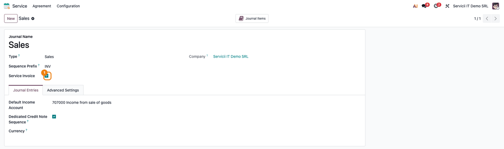

2. Create an agreement type in **Service → Configuration → Services Agreement Type** and pick the sales journal
   (required). Optionally create **Service Group** records to group agreements in reports.

   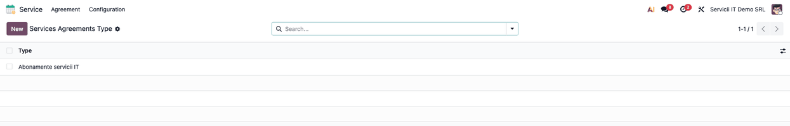

3. Check the billing cycles and the service periods (**Service → Configuration → Cycle** and **Date Ranges**):
   preparing the billing needs a period for the month you invoice.

## Usage

### 1. Create an agreement

Open **Service → Agreement → Services Agreements** and click **New**.

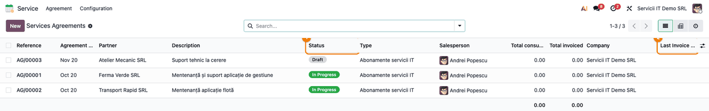

Fill in the **Partner**, the **Billing Cycle** and the **Invoice Day** (the day of the month; **-1** means the last
day of the month, **0** means no fixed day), the **Payment Terms**, and add the service lines with quantity, unit
price, **Quantity Free** (not invoiced) and, optionally, **Has free cycles** / **Free cycles**. Click **Set In
Progress** to activate the agreement.

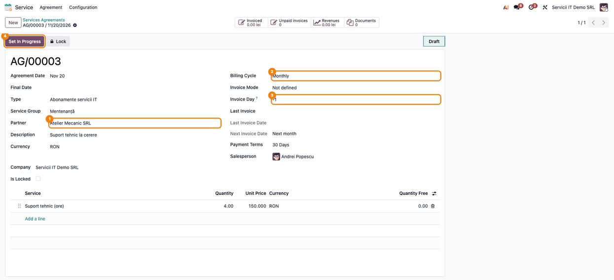

Only agreements **In Progress** are billed. The **Next Invoice Date** is computed from the last posted invoice (or
the agreement date), the cycle and the invoice day.

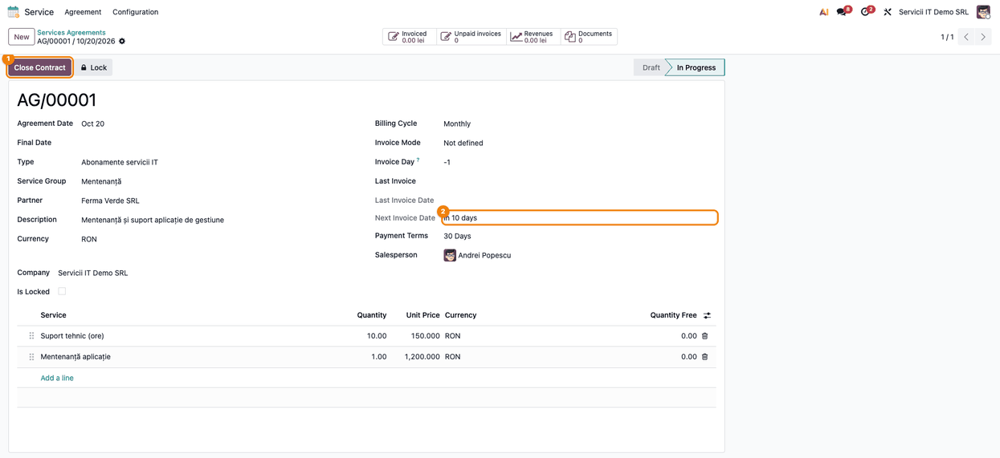

### 2. Prepare the billing

In the agreements list, select the agreements and click **Billing Preparation** (managers only). Pick the
**Period** (required) and click **Apply**: one consumption in the state *Without invoice* is created for each
agreement line.

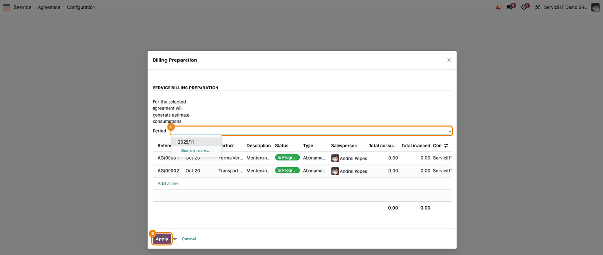

### 3. Check and correct the consumptions

Open **Service → Agreement → Services Consumption**. While a consumption is *Without invoice* you can correct its
quantity, price or partner on its form.

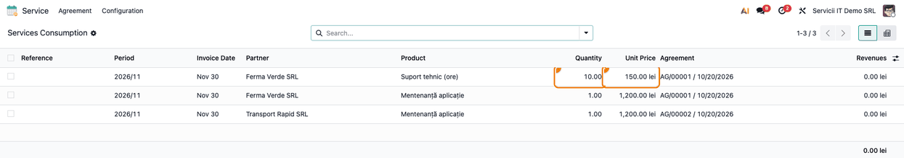

Select consumptions and use the **Action** menu for bulk changes:

- **Price Change**: sets a new unit price, currency and reference on the selected unbilled consumptions of a
  product. It also updates the list price of the product.

  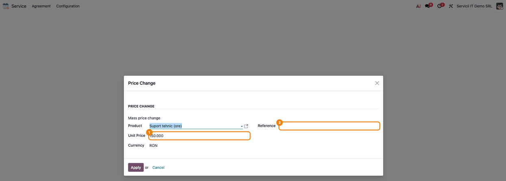

- **Distribution**: spreads a quantity or an amount over the selected consumptions (**Fix** gives each one the
  entered value, **Divide** splits it equally).

  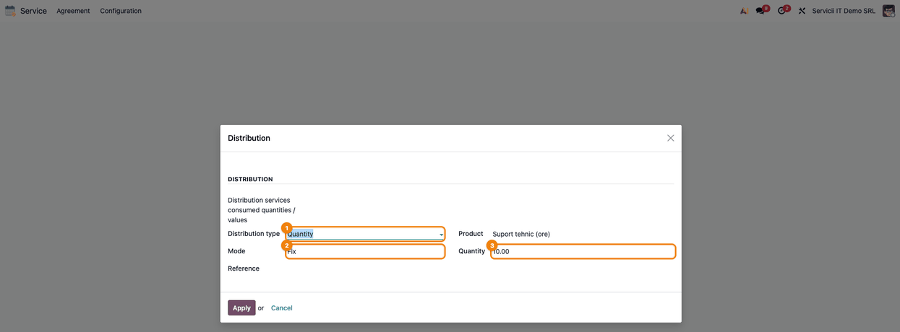

- **Change Invoice Date**: sets the invoice date of the selected unbilled consumptions.

  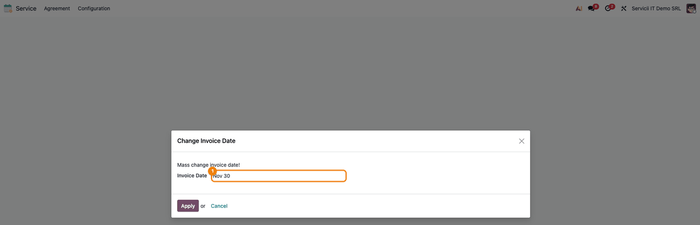

### 4. Invoice

Open **Service → Agreement → Billing** (or select consumptions and use **Action → Billing**). Choose the
**Journal**, how invoices are grouped (**Group by agreement**, **Group by partner** or **Split by agreement
line**) and optionally **Group by service**, then click **Apply**. Draft customer invoices are created and the
consumptions become *With invoice*. Consumptions that do not exceed the free quantity become *Not Applicable*.
A consumption with a negative quantity is invoiced as a correction that refers to the original invoice; if the
net amount of the document is negative, a credit note is created.

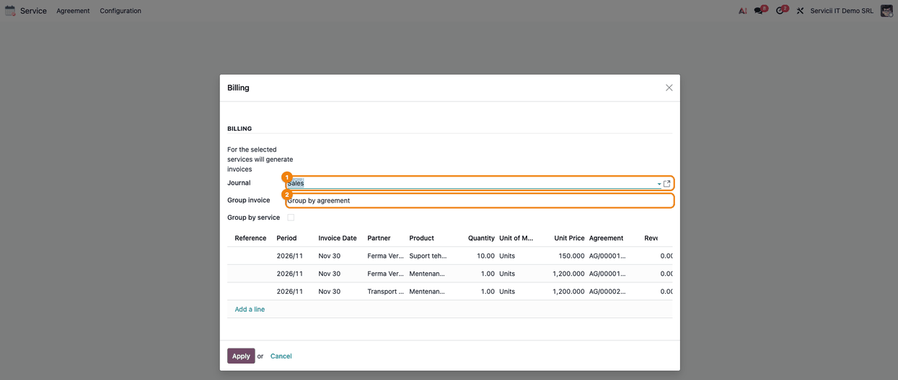

### 5. Check and post the invoices

The generated invoices open automatically; later use **Service → Agreement → Service Invoice**.

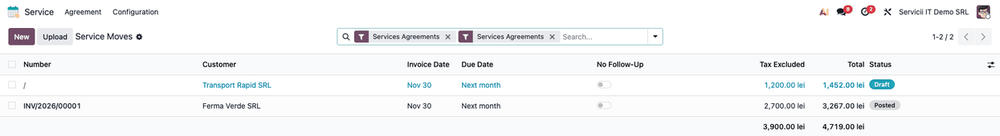

Open an invoice, check its lines and the note referring to the agreement, then confirm it. The **Consumption**
smart button opens its consumptions.

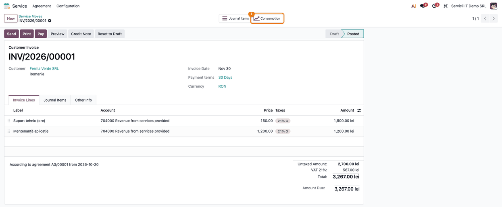

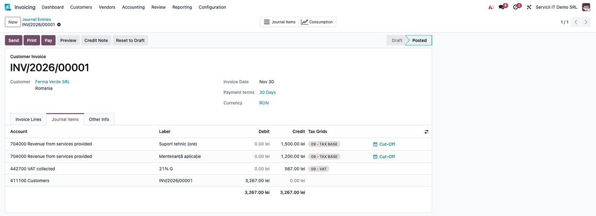

On posting, the agreement stores the **Last Invoice** and recomputes the **Next Invoice Date** and its totals.

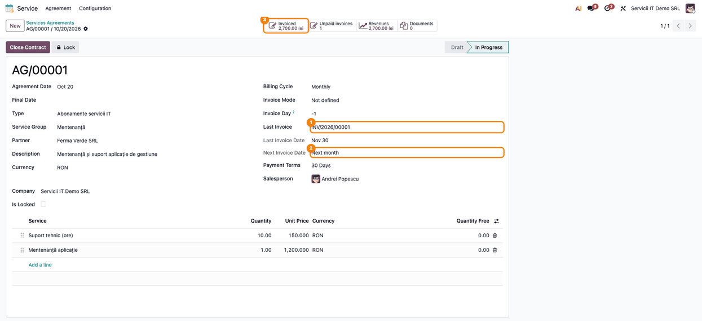

## Automatic billing

A daily scheduled action (**Billing automation**) prepares and invoices, as draft invoices, the agreements *In
Progress* with billing automation set to *Auto* that are due and have no consumption yet in the current month.
It needs exactly one service period for the current month and a sales journal for each company. The *Billing
automation* setting is not shown on the agreement form; by default agreements are *Manual*.

## Limitations

- Users without a service role can only read agreements and consumptions; service users cannot create
  agreements (managers can).
- An agreement can be deleted only in Draft, and an invoiced consumption cannot be deleted.
- Cancelling or deleting an invoice puts its consumptions back *Without invoice*.
